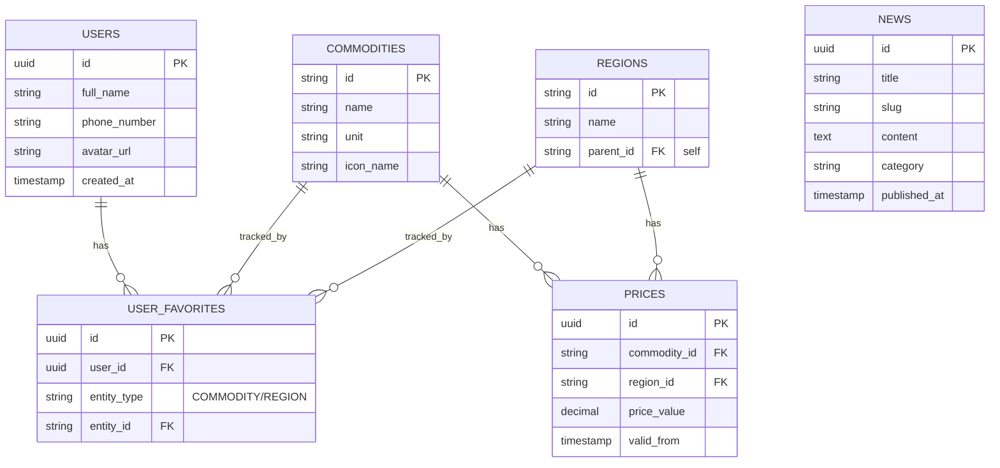

# Tổng quan Lược đồ Cơ sở dữ liệu (Database Schema)

## 1. Giới thiệu
Hệ thống NoroFarm sử dụng **Supabase PostgreSQL** làm cơ sở dữ liệu chính. Kiến trúc Database được thiết kế nhằm tối ưu cho các thao tác đọc (Read-heavy) đối với dữ liệu Giá cả/Tin tức, đồng thời đảm bảo bảo mật cấp độ dòng (Row Level Security - RLS) cho dữ liệu người dùng.

## 2. Các Schema (Lược đồ logic)
Thay vì ném tất cả vào lược đồ `public`, hệ thống phân chia các bảng theo Domain (Miền dữ liệu) để dễ quản lý. Tuy nhiên, trên Supabase, chúng ta vẫn ưu tiên dùng lược đồ `public` cho các bảng chính để client (Frontend) dễ truy xuất, và tạo các lược đồ riêng cho các xử lý nội bộ.

### Lược đồ `public` (Dữ liệu công khai & App Data)
- Chứa toàn bộ các bảng lõi mà Client App có thể truy vấn trực tiếp thông qua Supabase PostgREST API (Nếu áp dụng RLS).
- Bao gồm: `users_profile`, `commodities`, `regions`, `prices`, `news`, `user_favorites`.

### Lược đồ `auth` (Quản lý bởi Supabase)
- Chứa bảng `auth.users` và các bảng hệ thống để quản lý Authentication (Đăng nhập, Đăng ký, JWT). 

### Lược đồ `storage` (Quản lý File)
- Quản lý các Bucket chứa hình ảnh đại diện, ảnh thumbnail bài viết.

## 3. Sơ đồ Thực thể Liên kết (ER Diagram)

Dưới đây là sơ đồ Mermaid mô tả cấu trúc cốt lõi của Database:

