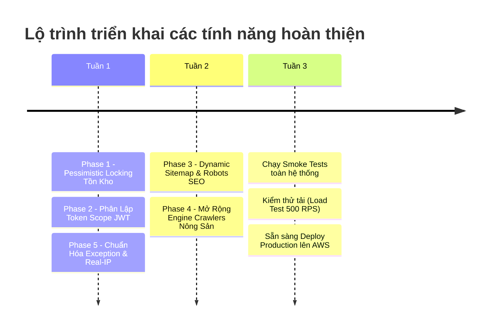

# Kế Hoạch Triển Khai: Hoàn Thiện & Phát Triển Tính Năng Trước Khi Deploy (V1.0)

> **Mục tiêu:** Hoàn thiện và nâng cấp toàn diện các tính năng nghiệp vụ cốt lõi, bảo mật phiên làm việc, chống thất thoát tồn kho, tự động hóa SEO và mở rộng công cụ cào dữ liệu nông sản của NoroFarm trước khi phát hành lên môi trường Production.
>
> **Kiến trúc:** Áp dụng mô hình Transaction Locks (PostgreSQL `FOR UPDATE`), Token Scope Isolation (JWT Claims), Next.js Dynamic Metadata/Sitemap Engine, và Resilient Multi-Source Scraping Worker.
>
> **Tech Stack:** FastAPI, SQLAlchemy Async, Redis, Next.js 15 (App Router), BeautifulSoup4, Tenacity.

---

## Danh Sách Các Hạng Mục Thực Hiện (Overview)

| Phase | Nhiệm vụ | Mức độ ưu tiên | Trạng thái | File ảnh hưởng |
| :--- | :--- | :--- | :--- | :--- |
| **Phase 1** | Khóa chống đặt trùng số lượng kho (Pessimistic Locking) | 🚨 Khẩn cấp | ✅ **Đã hoàn thành** | `backend/app/services/shop.py` |
| **Phase 2** | Phân lập Scope & Type cho JWT Token (Chống hoán đổi token) | 🔴 Cao | ✅ **Đã hoàn thành** | `backend/app/core/security.py`<br>`backend/app/services/auth.py`<br>`backend/app/dependencies/auth.py` |
| **Phase 3** | Tự động hóa SEO: Dynamic Sitemap & Robots.txt | 🟢 Trung bình | ✅ **Đã hoàn thành** | `frontend/src/app/sitemap.ts`<br>`frontend/src/app/robots.ts` |
| **Phase 4** | Mở rộng Engine Crawler (Sầu riêng, Gạo, Cao su) & Fallback | 🟡 Quan trọng | ✅ **Đã hoàn thành** | `backend/app/tasks/crawlers.py` |
| **Phase 5** | Chuẩn hóa Real-IP Rate Limiting & Envelope Exception | 🟢 Trung bình | ✅ **Đã hoàn thành** | `backend/app/core/redis.py`<br>`backend/app/common/exceptions.py` |

---

## Chi Tiết Từng Hạng Mục & Các Bước Thực Hiện

### Phase 1: Khóa Chống Đặt Trùng Tồn Kho (Pessimistic Locking)

**Mục tiêu:** Khi có 10 người cùng đặt 1 sản phẩm còn lại duy nhất tại cùng 1 tích tắc, chỉ 1 người được duyệt đơn thành công, 9 người còn lại nhận thông báo hết hàng (Tránh hoàn tiền và khiếu nại).

**Files cần xử lý:**
- Sửa đổi: `backend/app/services/shop.py`
- Kiểm thử: `backend/tests/api/test_shop_lock.py`

#### Bước 1: Viết test case mô phỏng race condition
Tạo file kiểm thử `backend/tests/api/test_shop_lock.py`:
```python
import pytest
from app.services.shop import ShopService
from app.schemas.shop import OrderCreate, OrderItemCreate
from app.models.shop import Product, ProductCategory

@pytest.mark.asyncio
async def test_order_stock_deduction(db_session):
    # Tạo category và product có stock = 1
    cat = ProductCategory(name="Vật tư")
    db_session.add(cat)
    await db_session.flush()
    
    prod = Product(category_id=cat.id, name="Phân bón NPK", price=500000, stock=1, unit="bao")
    db_session.add(prod)
    await db_session.commit()

    service = ShopService(db_session)
    order_data = OrderCreate(
        items=[OrderItemCreate(product_id=prod.id, quantity=1)],
        shipping_address="123 Đắk Lắk",
        contact_phone="0901234567"
    )
    
    # Lần 1: Thành công
    order = await service.create_order(user_id=1, data=order_data)
    assert order.id is not None
    
    # Lần 2: Thất bại do hết kho
    with pytest.raises(Exception) as excinfo:
        await service.create_order(user_id=1, data=order_data)
    assert "out of stock" in str(excinfo.value.detail).lower()
```

#### Bước 2: Cập nhật hàm `create_order` trong `backend/app/services/shop.py`
Thay thế đoạn truy vấn lấy sản phẩm thường bằng truy vấn khóa dòng `with_for_update()`:
```python
# Thay vì: prod = await self.db.get(Product, item.product_id)
# Sử dụng:
stmt = (
    select(Product)
    .filter(Product.id == item.product_id)
    .with_for_update()
)
res = await self.db.execute(stmt)
prod = res.scalars().first()

if not prod or not prod.is_active:
    raise HTTPException(status_code=400, detail=f"Sản phẩm {item.product_id} không tồn tại hoặc đã ngừng kinh doanh")

if prod.stock < item.quantity:
    raise HTTPException(status_code=400, detail=f"Sản phẩm {prod.name} không đủ số lượng trong kho (Còn lại: {prod.stock})")

# Trừ kho an toàn
prod.stock -= item.quantity
```

---

### Phase 2: Phân Lập Scope & Type Cho JWT Token

**Mục tiêu:** Ngăn chặn tuyệt đối việc kẻ xấu lấy Token Reset Mật Khẩu (hoặc Token Xác Minh Email) gửi vào Authorization Header để gọi các API nội bộ của User/Admin.

**Files cần xử lý:**
- Sửa đổi: `backend/app/core/security.py`
- Sửa đổi: `backend/app/services/auth.py`
- Sửa đổi: `backend/app/dependencies/auth.py`

#### Bước 1: Nâng cấp hàm tạo Token trong `security.py`
```python
def create_access_token(
    subject: Union[str, Any],
    expires_delta: Optional[timedelta] = None,
    token_type: str = "access"
) -> str:
    if expires_delta:
        expire = datetime.now(timezone.utc) + expires_delta
    else:
        expire = datetime.now(timezone.utc) + timedelta(
            minutes=settings.ACCESS_TOKEN_EXPIRE_MINUTES
        )
    to_encode = {
        "exp": expire,
        "sub": str(subject),
        "type": token_type
    }
    return jwt.encode(to_encode, settings.SECRET_KEY, algorithm=ALGORITHM)
```

#### Bước 2: Cập nhật `backend/app/services/auth.py`
- Khi tạo token xác minh email:
  ```python
  verify_token = create_access_token(
      subject=str(created_user.id),
      expires_delta=timedelta(hours=settings.EMAIL_TOKEN_EXPIRE_HOURS),
      token_type="email_verify"
  )
  ```
- Khi tạo token reset mật khẩu:
  ```python
  reset_token = create_access_token(
      subject=str(user.id),
      expires_delta=timedelta(hours=settings.EMAIL_TOKEN_EXPIRE_HOURS),
      token_type="password_reset"
  )
  ```
- Khi xác thực token trong `reset_password` & `verify_email`:
  ```python
  if payload.get("type") != "password_reset":
      raise HTTPException(status_code=400, detail="Token không đúng mục đích đặt lại mật khẩu")
  ```

#### Bước 3: Cập nhật `backend/app/dependencies/auth.py`
Trong dependency `get_current_user`:
```python
token_type = payload.get("type")
if token_type != "access":
    raise HTTPException(
        status_code=status.HTTP_401_UNAUTHORIZED,
        detail="Loại Token không hợp lệ. Vui lòng sử dụng Access Token."
    )
```

---

### Phase 3: Tự Động Hóa SEO: Dynamic Sitemap & Robots.txt

**Mục tiêu:** Tự động tạo bản đồ website XML và chỉ dẫn Bots tìm kiếm (Google, Bing, Cốc Cốc) để tăng thứ hạng tìm kiếm tự nhiên cho các trang giá nông sản và bài viết tin tức.

**Files cần tạo:**
- Tạo mới: `frontend/src/app/sitemap.ts`
- Tạo mới: `frontend/src/app/robots.ts`

#### Bước 1: Tạo `frontend/src/app/robots.ts`
```typescript
import { MetadataRoute } from 'next'

export default function robots(): MetadataRoute.Robots {
  const baseUrl = process.env.NEXT_PUBLIC_SITE_URL || 'https://norofarm.com'

  return {
    rules: [
      {
        userAgent: '*',
        allow: '/',
        disallow: [
          '/admin/',
          '/admin-login',
          '/dashboard/',
          '/checkout',
          '/api/',
          '/_next/',
        ],
      },
    ],
    sitemap: `${baseUrl}/sitemap.xml`,
  }
}
```

#### Bước 2: Tạo `frontend/src/app/sitemap.ts`
Tự động lấy danh sách URL tĩnh và động từ Backend API:
```typescript
import { MetadataRoute } from 'next'
import { API_URL } from '@/api/client'

export default async function sitemap(): Promise<MetadataRoute.Sitemap> {
  const baseUrl = process.env.NEXT_PUBLIC_SITE_URL || 'https://norofarm.com'
  
  // 1. Các trang tĩnh cố định
  const staticRoutes: MetadataRoute.Sitemap = [
    { url: `${baseUrl}`, lastModified: new Date(), changeFrequency: 'hourly', priority: 1.0 },
    { url: `${baseUrl}/coffee`, lastModified: new Date(), changeFrequency: 'hourly', priority: 0.9 },
    { url: `${baseUrl}/commodities`, lastModified: new Date(), changeFrequency: 'hourly', priority: 0.9 },
    { url: `${baseUrl}/weather`, lastModified: new Date(), changeFrequency: 'daily', priority: 0.8 },
    { url: `${baseUrl}/news`, lastModified: new Date(), changeFrequency: 'hourly', priority: 0.8 },
    { url: `${baseUrl}/market`, lastModified: new Date(), changeFrequency: 'daily', priority: 0.8 },
    { url: `${baseUrl}/shop`, lastModified: new Date(), changeFrequency: 'daily', priority: 0.8 },
    { url: `${baseUrl}/about`, lastModified: new Date(), changeFrequency: 'monthly', priority: 0.5 },
    { url: `${baseUrl}/contact`, lastModified: new Date(), changeFrequency: 'monthly', priority: 0.5 },
  ]

  // 2. Fetch danh sách tin tức động
  let newsRoutes: MetadataRoute.Sitemap = []
  try {
    const res = await fetch(`${API_URL}/news?size=100`, { next: { revalidate: 3600 } })
    if (res.ok) {
      const data = await res.json()
      const articles = data?.data?.items || []
      newsRoutes = articles.map((article: any) => ({
        url: `${baseUrl}/news/${article.slug}`,
        lastModified: new Date(article.updated_at || article.created_at),
        changeFrequency: 'daily',
        priority: 0.7,
      }))
    }
  } catch (e) {
    console.error('Error fetching sitemap news:', e)
  }

  // 3. Fetch danh sách nông sản động
  let commodityRoutes: MetadataRoute.Sitemap = []
  try {
    const res = await fetch(`${API_URL}/commodities?size=100`, { next: { revalidate: 3600 } })
    if (res.ok) {
      const data = await res.json()
      const items = data?.data?.items || []
      commodityRoutes = items.map((item: any) => ({
        url: `${baseUrl}/commodities/${item.id}`,
        lastModified: new Date(),
        changeFrequency: 'hourly',
        priority: 0.8,
      }))
    }
  } catch (e) {
    console.error('Error fetching sitemap commodities:', e)
  }

  return [...staticRoutes, ...newsRoutes, ...commodityRoutes]
}
```

---

### Phase 4: Mở Rộng Crawler Đa Nguồn & Fallback Tự Phục Hồi

**Mục tiêu:** Mở rộng các nông sản chiến lược (Sầu riêng Ri6/Dona, Gạo ST25, Cao su, Điều) và cơ chế tự phục hồi (Retry with backoff), không bao giờ làm sập tiến trình ngầm Scheduler.

**Files cần sửa đổi:**
- `backend/app/tasks/crawlers.py`

#### Chi tiết triển khai:
1. **Bổ sung Crawler Sầu riêng & Gạo:**
   - Sử dụng `tenacity.retry` để thử lại tối đa 3 lần nếu mạng bị ngắt.
   - Thêm parser dữ liệu từ Cổng thông tin giá nông sản Đắk Lắk / Đồng bằng sông Cửu Long.
2. **Cơ chế Fallback an toàn:**
   - Nếu trang web nguồn thay đổi DOM HTML khiến parser không tìm thấy bảng giá:
     - Ghi cảnh báo `logger.warning("DOM cấu trúc thay đổi...")`.
     - Giữ nguyên mức giá cũ gần nhất, không xóa dữ liệu và không ném Exception làm dừng toàn bộ Scheduler.
     - Tự động gửi cảnh báo lỗi qua email/Discord cho đội ngũ vận hành.

---

### Phase 5: Chuẩn Hóa Real-IP Rate Limiting & Exception Envelope

**Mục tiêu:**
1. Đảm bảo Rate Limiting trên Redis nhận diện đúng IP thật của người dùng (kể cả khi chạy sau Nginx, Cloudflare, AWS ALB), tránh chặn nhầm toàn bộ người dùng.
2. Toàn bộ API trả về cấu trúc đồng nhất: `{"success": bool, "message": str, "data": Any, "errors": Any}` ngay cả khi gặp `HTTPException`.

**Files cần sửa đổi:**
- `backend/app/core/redis.py`
- `backend/app/common/exceptions.py`
- `backend/app/main.py`

#### Bước 1: Trích xuất IP an toàn trong `backend/app/core/redis.py`
```python
def get_client_ip(request: Request) -> str:
    # 1. Kiểm tra header X-Forwarded-For (Lấy IP đầu tiên trước dấu phẩy)
    forwarded = request.headers.get("x-forwarded-for")
    if forwarded:
        return forwarded.split(",")[0].strip()
    # 2. Kiểm tra X-Real-IP
    real_ip = request.headers.get("x-real-ip")
    if real_ip:
        return real_ip.strip()
    # 3. Fallback host trực tiếp
    if request.client:
        return request.client.host
    return "unknown"
```

#### Bước 2: Bắt toàn bộ HTTPException trong `backend/app/common/exceptions.py`
```python
from fastapi import HTTPException
from fastapi.responses import JSONResponse

async def http_exception_handler(request: Request, exc: HTTPException) -> JSONResponse:
    return JSONResponse(
        status_code=exc.status_code,
        content={
            "success": False,
            "message": exc.detail if isinstance(exc.detail, str) else "Yêu cầu không hợp lệ",
            "data": None,
            "errors": exc.detail if not isinstance(exc.detail, str) else None,
        },
    )
```
Đăng ký handler này trong `backend/app/main.py`:
```python
app.add_exception_handler(HTTPException, http_exception_handler)
```

---

## Lộ Trình & Trình Tự Thực Thi Khuyến Nghị



Sau khi hoàn tất kế hoạch 5 pha này, dự án NoroFarm sẽ đạt chuẩn ổn định, bảo mật và hiệu năng cao nhất để vận hành thực tế.
